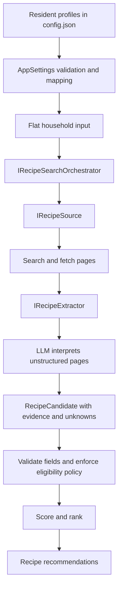

# RecipeFetcherAgent

RecipeFetcherAgent recommends recipes for a household by searching the web and asking an AI agent to evaluate candidate recipes against household preferences and restrictions.

## Configuration

Edit `RecipeFetcher/RecipeFetcher/config.json` to configure residents. Each resident has a stable ID, a name, and individual recipe preferences:

```json
{
  "residents": [
    {
      "id": "alex",
      "name": "Alex",
      "food_preferences": ["Italian", "weeknight-friendly"],
      "max_cook_time_minutes": 30,
      "dietary_restrictions": ["vegetarian"],
      "skill_level": "intermediate",
      "budget": "moderate"
    },
    {
      "id": "jordan",
      "name": "Jordan",
      "food_preferences": ["spicy", "one-pot meals"],
      "max_cook_time_minutes": 20,
      "dietary_restrictions": ["vegetarian"],
      "skill_level": "beginner",
      "budget": "low-cost"
    }
  ]
}
```

`food_preferences` and `dietary_restrictions` are arrays; use empty arrays when a resident has no values for either field. `max_cook_time_minutes`, `skill_level`, and `budget` are optional. Cook-time limits must be positive when supplied. Skill levels are `beginner`, `intermediate`, or `advanced`.

At startup, `AppSettings` loads and validates the resident configuration. The application maps it to one flat JSON input for the agent:

- `household_size`: number of configured residents.
- `food_preferences`: unique preferences across residents, preserving first-seen order.
- `dietary_restrictions`: unique combined restrictions; the agent treats every restriction as a hard constraint.
- `max_cook_time_minutes`: the shortest limit configured by any resident, or omitted if none is set.
- `skill_level`: the highest configured level (`beginner` < `intermediate` < `advanced`), or omitted if none is set.
- `budget`: unique non-empty budget values combined as a comma-separated string, or omitted if none is set.

The configuration is validated for at least one resident, non-null resident entries and preference/restriction arrays, non-empty unique IDs and names, non-blank array values, positive cook-time limits, and valid skill levels. Resident IDs are unique case-insensitively after trimming whitespace.

## Run

Prerequisites: the .NET 10 SDK and API keys for Anthropic and Tavily. From the repository root, set the keys in your PowerShell environment and run:

```powershell
$env:ANTHROPIC_API_KEY = "<your-anthropic-api-key>"
$env:TAVILY_API_KEY = "<your-tavily-api-key>"
dotnet run --project .\RecipeFetcher\RecipeFetcher\RecipeFetcher.csproj
```

The app loads the resident profile and agent definition from its output directory, searches and fetches candidate recipe pages through Tavily, invokes the Anthropic agent, and writes the result to the console. Both API keys are required at runtime; do not put them in `config.json` or commit them. API calls may incur provider usage charges.

## Agent behavior

The recommender instructions are in `RecipeFetcher/RecipeFetcher/Agents/recipe-recommender.agent.md`. The agent searches and fetches candidate pages, applies dietary restrictions as hard filters, scores eligible recipes, and returns up to three recommendations. Its instructions require it to distinguish verified facts from unknown details, avoid claiming a candidate count it did not verify, clearly identify recipes over the configured time limit, and use fetched pages only as sources of recipe information.

The agent definition's YAML frontmatter selects the provider, model, tools, and temperature. The current application supports the `anthropic` provider. Its configured tools are `WebSearch` (Tavily search, up to five results by default) and `FetchPage` (Tavily page extraction). Update the agent definition and the matching registered tools together if changing the tool list.

## Development and tests

Run all repository tests from the root:

```powershell
dotnet test .\RecipeFetcher\RecipeFetcher.slnx
```

The test project is `RecipeFetcher/RecipeFetcher.Tests`. Tests cover agent definition parsing, provider selection, tool registration, Tavily client behavior, and resident configuration validation and mapping. Tests for the configuration mapping do not require live API keys.

## Project layout

- `RecipeFetcher/RecipeFetcher/Program.cs`: application startup and agent invocation.
- `RecipeFetcher/RecipeFetcher/config.json`: resident-level household configuration.
- `RecipeFetcher/RecipeFetcher/Agents/recipe-recommender.agent.md`: agent metadata and recommender instructions.
- `RecipeFetcher/RecipeFetcher/Domain`: configuration, agent definition, and Tavily response records.
- `RecipeFetcher/RecipeFetcher/Services`: Anthropic agent factory and Tavily client boundary.
- `RecipeFetcher/RecipeFetcher.Tests`: automated tests.

## Future considerations

Recipe websites expose inconsistent and often unstructured information. An LLM can interpret fetched pages and extract recipe details into a common `RecipeCandidate` shape, including evidence and unknown or uncertain fields. Keep this capability behind an `IRecipeExtractor` boundary so it can be tested with a fake implementation.

An `IRecipeSearchOrchestrator` should own the workflow: select pages to fetch, invoke extraction, handle missing fields or failures, enforce eligibility policy, and score and rank candidates. This makes the LLM a specialist interpreter rather than the autonomous workflow driver. Hard requirements such as dietary restrictions should be handled by explicit application policy; uncertain or missing information should not be treated as verified.


