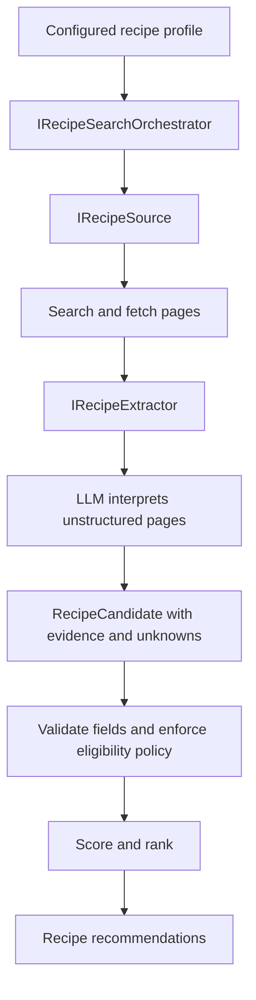

# RecipeFetcherAgent
I need new recipe ideas so I'm offloading to @copilot

## Future Considerations

Recipe websites expose inconsistent and often unstructured information. An LLM can interpret fetched pages and extract recipe details into a common `RecipeCandidate` shape, including evidence and unknown or uncertain fields. Keep this capability behind an `IRecipeExtractor` boundary so it can be tested with a fake implementation.

An `IRecipeSearchOrchestrator` should own the workflow: select pages to fetch, invoke extraction, handle missing fields or failures, enforce eligibility policy, and score and rank candidates. This makes the LLM a specialist interpreter rather than the autonomous workflow driver. Hard requirements such as dietary restrictions should be handled by explicit application policy; uncertain or missing information should not be treated as verified.

